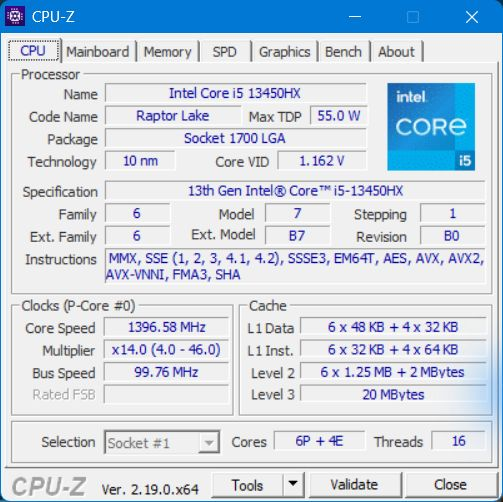
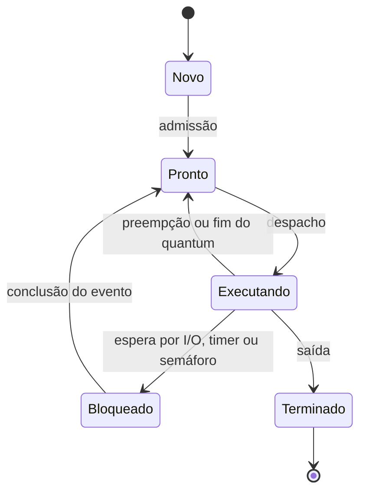
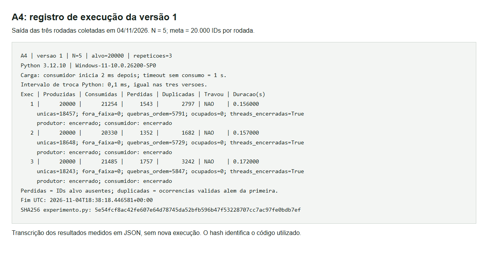
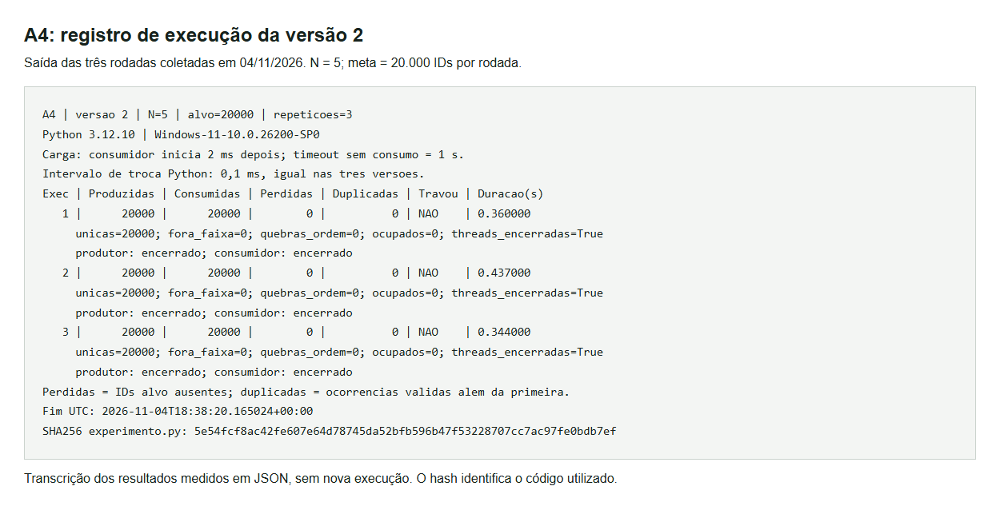
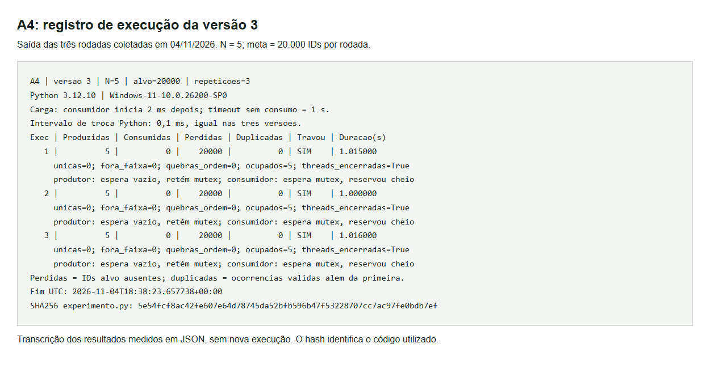
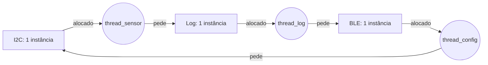

Thúlio Sallum Bacco Pinto | D1 = 6 | D2 = 2 | N = 5

# Tato: do pipeline ao deadlock

## Parte A: o problema técnico

### Parâmetros individuais

O acento de “Thúlio” não altera a contagem: ú é uma letra.

| Nome | Letras |
|---|---:|
| Thúlio | 6 |
| Sallum | 6 |
| Bacco | 5 |
| Pinto | 5 |
| **Total** | **22** |

```text
D1 = 6
D2 = 22 mod 10 = 2
N = 3 + (2 mod 5) = 5 posições
IC = 100.000 + 20.000 × 2 = 140.000 instruções/amostra
m = 3% + 0,5% × 6 = 6% = 0,06
Período entre amostras = 1/100 s = 10 ms
Prazo por amostra = 5 ms
```

### A1. Arquitetura e memória

#### 1. Plataforma H

O tempo de CPU é o número de instruções multiplicado pelos ciclos por instrução, dividido pelo clock:

```text
T_H = IC × CPI / f
    = 140.000 × 1,5 / 48.000.000
    = 210.000 / 48.000.000 s
    = 0,004375 s = 4,375 ms
Margem = 5 − 4,375 = 0,625 ms
```

A H atende ao limite de 5 ms no modelo fornecido. O período de 10 ms permite iniciar uma nova amostra a cada período; ele não substitui o prazo de 5 ms para concluir cada uma. O cálculo ocupa 43,75% desse período.

#### 2. Plataforma V

Adoto 120 ciclos como **penalidade adicional** de uma falta, conforme a fórmula de CPI prescrita pelo enunciado. O acerto de um ciclo já está incluído no CPI básico; somá-lo novamente no CPI contaria esse custo duas vezes.

```text
AMAT = tempo de acerto + taxa de falta × penalidade
     = 1 + 0,06 × 120 = 8,2 ciclos/acesso
Período de clock = 1 / 1.200.000.000 s = 0,833333… ns
AMAT = 8,2 × 0,833333… = 6,833333… ns/acesso

CPI_efetivo = 1,0 + 1,3 × 0,06 × 120
            = 1,0 + 9,36 = 10,36 ciclos/instrução

T_V = 140.000 × 10,36 / 1.200.000.000
    = 1.450.400 / 1.200.000.000 s
    = 1,208666… ms

T_V com atraso máximo do SO = 1,208666… + 3 = 4,208666… ms
Margem = 5 − 4,208666… = 0,791333… ms
```

Pelo procedimento solicitado, a V também atende aos 5 ms. Entretanto, esse “pior caso” soma o atraso máximo do SO a um tempo de CPU calculado com uma taxa média de faltas. Ele não é um limite absoluto do pior tempo de execução, ou WCET: uma amostra pode ter mais faltas que a média. A garantia real exige limites para memória, interrupções, escalonamento e I/O no caminho completo até o comando de vibração.

#### 3. DSP na Plataforma H: Lei de Amdahl

O filtro representa 60% do tempo; os outros 40% permanecem iguais. Acelerar apenas o filtro cinco vezes não acelera a aplicação inteira cinco vezes.

```text
Speedup global = 1 / [(1 − 0,60) + 0,60/5]
               = 1 / (0,40 + 0,12)
               = 1/0,52 = 1,923076… vezes

T_H+DSP = 4,375 × 0,52 = 2,275 ms
Conferência: parte não acelerada = 4,375 × 0,40 = 1,750 ms
             filtro acelerado = (4,375 × 0,60)/5 = 0,525 ms
             total = 1,750 + 0,525 = 2,275 ms
Margem = 5 − 2,275 = 2,725 ms
```

A H com DSP atende e libera 2,100 ms em relação à H sem DSP. Esses valores pressupõem o ganho de cinco vezes e a divisão de trabalho dados no exercício, sem custos adicionais de comunicação com o acelerador.

| Opção | Tempo de cálculo | Tempo com atraso do SO informado | Margem até 5 ms |
|---|---:|---:|---:|
| H | 4,375 ms | 4,375 ms | 0,625 ms |
| V | 1,209 ms | 4,209 ms | 0,791 ms |
| H + DSP | 2,275 ms | 2,275 ms | 2,725 ms |

#### 4. Por que V precisa de cache e H funciona sem?

Na V, DRAM lenta e caminho compartilhado criam o gargalo de Von Neumann.<br>
A cache reduz acessos à DRAM ao aproveitar localidade.<br>
Na H, SRAM de um ciclo e caminhos separados já atendem à CPU.<br>
Por isso ela dispensa cache neste modelo; RISC não determina seu uso.

#### 5. Evidência das caches do computador



O computador tem um Intel Core i5-13450HX, com seis P-cores, quatro E-cores e 16 threads lógicas. Nesta máquina, o CPU-Z 2.19 não exibiu uma aba Caches separada; a captura mostra os campos de cache disponíveis na aba CPU, sem alterar os dados exibidos.

| Nível | Informação visível no CPU-Z |
|---|---|
| L1 de dados | 6 × 48 KB + 4 × 32 KB |
| L1 de instruções | 6 × 32 KB + 4 × 64 KB |
| L2 | 6 × 1,25 MB + 2 MB |
| L3 | 20 MB |

A L1 é dividida entre instruções e dados. Classifico o computador como **Von Neumann no modelo de programação, com organização Harvard modificada na L1**: instruções e dados pertencem a um espaço de memória unificado, mas usam caches e caminhos separados próximos aos núcleos. A divisão da L1 não transforma toda a máquina em Harvard puro. O print evidencia a divisão das caches; a classificação considera também a organização da memória, não apenas seus tamanhos.

### A2. Pipeline do filtro

As instruções são identificadas pela numeração original:

```asm
I1: lw   x5, 0(x10)
I2: add  x6, x6, x5
I3: lw   x7, 0(x11)
I4: sub  x6, x6, x7
I5: sw   x6, 0(x12)
I6: addi x10, x10, 4
I7: addi x11, x11, 4
```

#### 1. Dependências RAW

| Instrução que produz o valor | Instrução que o lê | Registrador |
|---|---|---|
| I1 | I2 | x5 |
| I2 | I4 | x6 |
| I3 | I4 | x7 |
| I4 | I5 | x6, dado a armazenar |

I5 lê o x6 produzido por I4, que substitui o valor de I2; portanto, I2 → I5 não é uma RAW direta. I6 e I7 modificam ponteiros já lidos por I1 e I3: são antidependências WAR, que precisam ser preservadas na reordenação. A leitura do x6 anterior por I2 é um valor de entrada do trecho.

#### 2. Sem forwarding

Nos diagramas, `ME` representa MEM; `ID*` e `IF*` indicam estágios retidos por uma parada. Cada repetição marcada provoca ou acompanha uma bolha. Considero execução em ordem e ausência de conflito estrutural entre busca e acesso a dados. `WB` do `sw` é apenas sua posição final, sem escrita em registrador.

```text
Ciclo  01  02  03  04  05  06  07  08  09  10  11  12  13  14  15  16  17
I1     IF  ID  EX  ME  WB
I2         IF  ID  ID* ID* EX  ME  WB
I3             IF  IF* IF* ID  EX  ME  WB
I4                         IF  ID  ID* ID* EX  ME  WB
I5                             IF  IF* IF* ID  ID* ID* EX  ME  WB
I6                                         IF  IF* IF* ID  EX  ME  WB
I7                                                     IF  ID  EX  ME  WB
```

I2 só lê x5 no ciclo 5, quando I1 escreve. I4 só lê x7 no ciclo 9, quando I3 escreve; x6 de I2 já está disponível desde o ciclo 8. I5 só lê x6 no ciclo 12, quando I4 escreve. A escrita na primeira metade e a leitura na segunda metade permitem ID e WB no mesmo ciclo, sem uma espera extra.

```text
Total = 7 instruções + (5 − 1) ciclos para preencher/esvaziar
        + 2 paradas em I2 + 2 em I4 + 2 em I5
      = 7 + 4 + 6 = 17 ciclos, do IF de I1 ao WB de I7
```

#### 3. Com forwarding

Considero forwarding completo, inclusive para o dado que o `sw` armazena.

```text
Ciclo  01  02  03  04  05  06  07  08  09  10  11  12  13
I1     IF  ID  EX  ME  WB
I2         IF  ID  ID* EX  ME  WB
I3             IF  IF* ID  EX  ME  WB
I4                     IF  ID  ID* EX  ME  WB
I5                         IF  IF* ID  EX  ME  WB
I6                                 IF  ID  EX  ME  WB
I7                                     IF  ID  EX  ME  WB
```

```text
Total = 7 + 4 + 1 parada em I2 + 1 em I4 = 13 ciclos
```

As dependências imediatas de carga e uso, I1 → I2 (x5) e I3 → I4 (x7), ainda exigem uma bolha cada. O `lw` entrega o dado ao fim de MEM; a instrução imediatamente seguinte precisaria dele no início de EX desse mesmo ciclo. O encaminhamento não faz o dado chegar antes de ser produzido. As dependências de ALU são atendidas por forwarding, assim como o dado do `sw`.

#### 4. Reordenação sem bolhas

```asm
lw   x5, 0(x10)       # I1
lw   x7, 0(x11)       # I3
add  x6, x6, x5       # I2
sub  x6, x6, x7       # I4
sw   x6, 0(x12)       # I5
addi x10, x10, 4      # I6
addi x11, x11, 4      # I7
```

```text
Ciclo  01  02  03  04  05  06  07  08  09  10  11
I1     IF  ID  EX  ME  WB
I3         IF  ID  EX  ME  WB
I2             IF  ID  EX  ME  WB
I4                 IF  ID  EX  ME  WB
I5                     IF  ID  EX  ME  WB
I6                         IF  ID  EX  ME  WB
I7                             IF  ID  EX  ME  WB
```

Cada carga passa a ter uma instrução independente antes do uso de seu resultado. Só movi I3 sobre I2, que opera em registradores; as leituras continuam antes da escrita em memória e dos incrementos dos respectivos ponteiros. Logo, a transformação preserva o resultado do trecho inclusive se os endereços coincidirem, para acessos válidos a memória comum. Não pressuponho reordenar I/O com efeitos colaterais.

```text
Total = 7 + 4 + 0 = 11 ciclos
Redução perante o original com forwarding = (13 − 11)/13 ≈ 15,38%
```

### A3. Processos e threads na Plataforma V

#### 1. Organização proposta

Um processo de controle mantém três threads persistentes: leitura do sensor, processamento e acionamento do motor. Elas compartilham filas limitadas e o estado necessário a cada amostra; as atualizações concorrentes são protegidas. Crio as threads na inicialização, sem criar uma nova a cada 10 ms. A tarefa periódica usa espera passiva e horários absolutos para reduzir deriva.

O BLE fica em um processo separado. A comunicação entre processos, ou IPC, transporta cópias de logs e comandos com tamanho e frequência limitados. O controle valida tipo, tamanho, faixa e autorização de cada comando, aplicando configurações em uma fronteira segura entre amostras. O processo BLE não recebe acesso irrestrito à memória nem ao dispositivo do motor.

```text
Processo de controle
  sensor → fila limitada → processamento → fila limitada → motor
                memória compartilhada e sincronização
                         │ logs sem bloqueio
                         ▼
                    IPC limitado ⇄ processo BLE ⇄ celular
                         ▲
                 configurações validadas
```

Threads compartilham espaço de endereços e, em geral, exigem menos recursos para criação e troca de contexto que processos independentes. Isso facilita passar amostras sem cópias por IPC, mas uma falha de memória pode atingir todo o controle. O processo BLE custa memória e comunicação adicionais; em troca, seu reinício e suas falhas ficam mais isolados. Não há um custo numérico universal de troca de contexto: cache, implementação e carga também influenciam.

O envio do log nunca deve bloquear a cadeia sensor → motor. Se a fila de telemetria encher, descarto ou agrego logs e conto os descartes. Isso sacrifica completude do histórico para preservar o processamento local. As filas de amostras exigem dimensionamento e análise de atraso: acumular amostras por 10 ms já pode violar o prazo de 5 ms. O desenho organiza as responsabilidades, mas não demonstra, sozinho, atendimento temporal no Linux.

#### 2. Consequência de uma falha explorável no BLE

Como thread do controle, o BLE tem o mesmo espaço de endereços: código comprometido pode adulterar amostras, ponteiros, configuração ou a saída do motor, além de derrubar o processo inteiro. Como processo com privilégios mínimos, uma escrita arbitrária fica restrita ao seu espaço e o controle pode reiniciá-lo. A proteção depende de permissões de dispositivos e IPC bem definidos; não elimina abuso de comandos válidos, consumo excessivo de recursos, falhas do kernel ou vulnerabilidades no próprio controle.

#### 3. Estados de um processo



Esse é o modelo didático de cinco estados. Em um sistema com threads, o escalonador acompanha o estado de cada thread. Supondo uma leitura curta e espera passiva pelo próximo período, a thread do sensor passa a maior parte do tempo **bloqueada**, esperando o timer de 10 ms ou a conclusão da leitura. Quando o evento acontece, fica pronta e aguarda despacho; não vai diretamente de bloqueada a executando. Sem o tempo de I/O, não é possível calcular a proporção exata em cada estado.

### A4. Buffer circular com N = 5

#### Procedimento e resultados

Os programas estão em [codigo/](codigo/). Cada versão executa três rodadas independentes com 20.000 IDs, de 0 a 19.999, e reinicializa buffer, índices e primitivas a cada rodada. Os comandos estão no [README](../README.md).

A coleta foi feita em 04/11/2026, no Windows 11, com CPython 3.12.10. É um teste de concorrência acelerado, sem simular os 10 ms entre leituras. Todas as versões usam um atraso inicial de 2 ms no consumidor para exercitar o buffer cheio e intervalo de troca do Python de 0,1 ms, restaurado ao final. Essas condições são iguais entre versões e estão impressas pelo programa; os tempos totais abaixo não são medidas de latência da pulseira.

| Versão | Execução | Produzidas | Consumidas | Perdidas | Duplicadas | Travou | Duração (s) |
|---|---:|---:|---:|---:|---:|:---:|---:|
| V1 | 1 | 20.000 | 21.254 | 1.543 | 2.797 | Não | 0,156 |
| V1 | 2 | 20.000 | 20.330 | 1.352 | 1.682 | Não | 0,157 |
| V1 | 3 | 20.000 | 21.485 | 1.757 | 3.242 | Não | 0,172 |
| V2 | 1 | 20.000 | 20.000 | 0 | 0 | Não | 0,360 |
| V2 | 2 | 20.000 | 20.000 | 0 | 0 | Não | 0,437 |
| V2 | 3 | 20.000 | 20.000 | 0 | 0 | Não | 0,344 |
| V3 | 1 | 5 | 0 | 20.000 | 0 | Sim | 1,015 |
| V3 | 2 | 5 | 0 | 20.000 | 0 | Sim | 1,000 |
| V3 | 3 | 5 | 0 | 20.000 | 0 | Sim | 1,016 |

**Definições das contagens:** consumidas é o total de retiradas registradas; únicas válidas é a quantidade de IDs distintos entre 0 e 19.999; perdidas = 20.000 − únicas válidas; duplicadas conta cada ocorrência válida além da primeira. Assim, consumidas = únicas válidas + duplicadas + valores fora da faixa. Valores fora da faixa foram zero nas nove rodadas. Perdas aqui significam IDs-alvo ausentes ao término, inclusive os ainda não produzidos se a execução trava.

Na V1, o produtor gerou os 20.000 IDs, mas todas as rodadas apresentaram perdas e duplicações. O consumidor drena até o produtor terminar e o contador indicar vazio; por isso, as duplicações podem elevar consumidas acima de 20.000. Por exemplo, na rodada 1: 20.000 − 1.543 + 2.797 = 21.254. A ausência de travamento não significa correção.

Na V2, os 20.000 IDs chegaram em ordem em cada rodada, sem perda, duplicação ou quebra de sequência. Na V3, o produtor gerou cinco IDs e ficou bloqueado antes de completar a meta. Os cinco permaneceram no buffer, e 19.995 nem chegaram a ser produzidos; por isso, os 20.000 IDs-alvo ficaram ausentes no consumo. Nas três rodadas, o diagnóstico registrou produtor esperando `vazio` enquanto retinha `mutex`, consumidor esperando `mutex` após reservar `cheio` e ocupação igual a cinco.

O monitor marcou travamento após pelo menos um segundo sem consumo e cancelou a execução, encerrando ambas as threads nas nove rodadas. Não ocorreram exceções. A quantidade exata de falhas da V1 depende do escalonamento; a possibilidade de deadlock da V3 decorre da ordem dos semáforos, e o atraso inicial favorece observá-la.

Os [registros completos da coleta](img/execucoes-a4.json) preservam ambiente, condições, horário UTC, hash do código executado e métricas de cada rodada. Os prints abaixo são capturas de uma página local que apresenta a transcrição desses mesmos registros, sem executar novamente nem modificar as contagens.







#### Região crítica da versão 1

A região crítica inclui testar a ocupação, acessar a posição do buffer, avançar o índice circular e atualizar o contador `ocupados`. A operação ler → calcular → escrever esse contador não é indivisível. Por exemplo, partindo de 1, o produtor pode ler 1 e o consumidor também ler 1; eles escrevem 2 e 0, embora a ocupação correta após uma inserção e uma retirada seja 1. Uma atualização é perdida.

O `time.sleep(0)` entre a leitura e a escrita do contador favorece essa intercalação. A inconsistência permite tratar um buffer cheio como livre ou um buffer vazio como ocupado, sobrescrevendo uma amostra ainda não lida ou relendo dados antigos. O GIL do CPython não torna uma sequência dessas operações uma transação atômica. Espera ocupada também desperdiça CPU enquanto a condição não muda.

#### O que os semáforos garantem na versão 2

| Semáforo | Valor inicial | Garantia |
|---|---:|---|
| `vazio` | 5 | Reserva uma posição antes de inserir; o produtor espera quando não há espaço. |
| `cheio` | 0 | Reserva um item existente antes de retirar; o consumidor espera quando não há dados. |
| `mutex` | 1 | Impede acesso simultâneo à seção que altera o buffer e os índices. |

```text
Produtor:   wait(vazio) → wait(mutex) → inserir → signal(mutex) → signal(cheio)
Consumidor: wait(cheio) → wait(mutex) → retirar → signal(mutex) → signal(vazio)
```

A reserva de espaço ou item acontece antes da aquisição do mutex. Assim, uma thread não mantém o mutex enquanto espera a outra produzir ou liberar capacidade. Fora de operações em andamento, `vazio + cheio = N`; durante uma operação, permissões já reservadas também fazem parte da contabilidade. Os testes observam integridade e término, não provam um limite temporal de 5 ms.

#### Por que a versão 3 pode travar

Ao inverter somente a ordem do produtor, ele pode segurar `mutex` e esperar `vazio` quando o buffer está cheio. O consumidor pode obter `cheio`, mas precisa de `mutex` para retirar e então liberar `vazio`. O produtor espera espaço que só o consumidor pode liberar; o consumidor espera o mutex que o produtor mantém. A espera é circular.

Os timeouts curtos usados no código permitem ao monitor observar a ausência de progresso e encerrar cooperativamente as threads. Eles não liberam o recurso em uma tentativa normal nem corrigem a ordem defeituosa. O resultado “travou” registra um segundo sem consumo antes da conclusão; a análise de dependências é que explica o deadlock da versão 3. Na versão 1, ausência de progresso pode decorrer do contador corrompido, sem esse mesmo ciclo de recursos.

### A5. Deadlock entre sensor, log e configuração

#### 1. Sequência e grafo de alocação

Com cada recurso protegido por um semáforo binário inicialmente livre:

1. `thread_sensor` executa `P(i2c)` e lê o sensor, mantendo I2C.
2. `thread_log` executa `P(log)` e lê o arquivo, mantendo log.
3. `thread_config` executa `P(ble)` e recebe o comando, mantendo BLE.
4. O sensor tenta `P(log)` e bloqueia: log está com a thread de log.
5. A thread de log tenta `P(ble)` e bloqueia: BLE está com a configuração.
6. A configuração tenta `P(i2c)` e bloqueia: I2C está com o sensor.

No grafo, recurso → thread indica alocação; thread → recurso indica pedido bloqueado. Há uma instância de cada recurso.



O ciclo é I2C → sensor → log → thread_log → BLE → configuração → I2C. Ninguém alcança os `V(...)` necessários para desfazê-lo.

#### 2. Quatro condições necessárias

| Condição | Manifestação no trecho |
|---|---|
| Exclusão mútua | Cada semáforo binário permite apenas uma thread usando seu recurso. |
| Posse e espera | Cada thread mantém o primeiro recurso enquanto pede o segundo. |
| Não preempção | Nenhum recurso é retirado automaticamente; o código só o libera ao alcançar `V`. |
| Espera circular | Sensor espera log; log espera BLE; configuração espera I2C, fechando o ciclo. |

As quatro condições estão presentes simultaneamente na sequência descrita. O ciclo, com recursos de instância única e pedidos bloqueados, caracteriza o deadlock.

#### 3. Duas correções e seus efeitos

**Prevenção por ordem global.** Estabeleço I2C < log < BLE. Sensor adquire I2C e depois log; log adquire log e depois BLE; qualquer seção da configuração que necessite dos dois recursos passa a adquirir I2C e depois BLE. A liberação segue a ordem inversa. Para não manter I2C enquanto se espera o celular, a configuração é dividida em fases:

```text
P(ble) → receber e copiar comando → V(ble)
validar cópia sem manter esses recursos
P(i2c) → aplicar configuração validada → V(i2c)
P(ble) → enviar confirmação → V(ble)
```

BLE é liberado antes de pedir I2C; a recepção não permanece aninhada com a aplicação. A ordem comum elimina a espera circular, e a divisão evita manter recursos durante a espera pelo segundo subsistema.

Para o usuário, isso evita o congelamento causado por esse ciclo. Logs e configurações podem esperar, enquanto a detecção deve continuar local. Ainda é preciso limitar seções críticas e retirar I/O de log/BLE do caminho de tempo crítico, preferencialmente com filas: a prevenção de deadlock não limita, por si, o tempo de bloqueio nem elimina inversão de prioridade.

**Detecção e recuperação cooperativa.** Um supervisor mantém o grafo de espera e procura ciclos; um timeout indica falta de progresso e dispara a inspeção, mas não prova deadlock sozinho. Detectado o ciclo, cancela uma operação não crítica de log ou configuração. Aquisições temporizadas permitem que a thread escolhida perceba o cancelamento, reverta alterações parciais e libere, em `finally`, somente os recursos que possui. Depois ela pode tentar novamente sem manter recursos enquanto espera.

Se a cooperação falhar, um reinício controlado é o último recurso. O aviso acessível deve informar a indisponibilidade e orientar a interrupção do deslocamento até o retorno do feedback. Para o usuário, recuperação significa perda de logs ou atraso de configuração e pode interromper a detecção de obstáculos. Se a recuperação impedir que uma amostra gere seu comando de vibração em até 5 ms, o prazo é violado; por isso, recuperação é uma contingência e não substitui a correção antes do uso. Liberar semáforos de outra thread indiscriminadamente permitiria continuar com dados inconsistentes.

## Parte B: a decisão do CTO

### Memorando ao conselho da Tato

**Assunto: dilema 2, processador para produção**

Decido produzir a Tato com a Plataforma H e o acelerador DSP. A A1 encontrou 4,375 ms na H sem acelerador: atende aos 5 ms do modelo, mas deixa apenas 0,625 ms de margem. O DSP reduz o cálculo para 2,275 ms e amplia a margem para 2,725 ms. Pago R$ 15 adicionais por unidade para reservar tempo à integração, sujeito à verificação do caminho completo no hardware.

O conjunto custa R$ 22 + R$ 15 = R$ 37, contra R$ 70 da V: economiza R$ 33 por unidade nos componentes informados. Abrimos mão de OTA e da conveniência do Linux. A empresa arcará com assistência e atualização por cabo; o usuário enfrentará deslocamento e possível indisponibilidade da pulseira. Esses custos de manutenção não foram quantificados. A H sem DSP seria R$ 15 mais barata, mas deixaria menos margem para I/O e interrupções.

Para quem usa a pulseira, a escolha prioriza resposta local, sem depender do celular para detectar obstáculos. Ela não resolve o deadlock da A5: corrigiremos a ordem dos recursos e manteremos logs fora do caminho crítico. A atualização por cabo pode atrasar correções de vulnerabilidades; firmware e comandos BLE continuam exigindo validação e controle de acesso, mesmo sem Linux.

Antes da produção, exigirei análise de pior caso e ensaios do caminho sensor → comando do motor sob carga, incluindo I/O, interrupções e comunicação com o DSP, dentro de 5 ms. Mudarei para V se o custo adicional de manutenção da H superar R$ 33 por unidade e a V demonstrar o prazo de 5 ms, com limites de memória e escalonamento e atualização autenticada. Nenhuma opção será liberada com violação conhecida do prazo.

### Referências

- Enunciado fornecido: *Ponderada Computação CC08: do pipeline ao deadlock*, seis páginas. Fonte dos dados das plataformas, requisitos, preços e dilemas.
- Python Software Foundation. [threading: semáforos e threads](https://docs.python.org/3.12/library/threading.html). Apoio para as primitivas usadas na A4.
- Python Software Foundation. [time.sleep](https://docs.python.org/3.12/library/time.html#time.sleep). Apoio para a cessão de execução na versão 1.
- CPUID. [CPU-Z](https://www.cpuid.com/softwares/cpu-z.html). Ferramenta da evidência de caches em A1.
